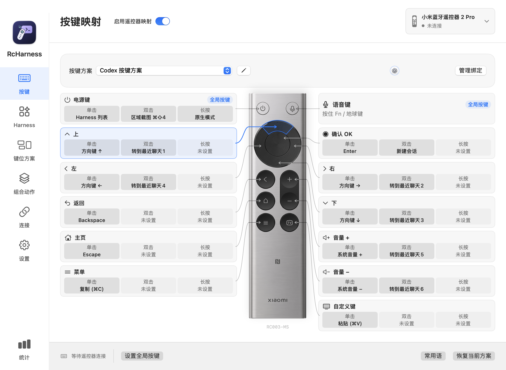
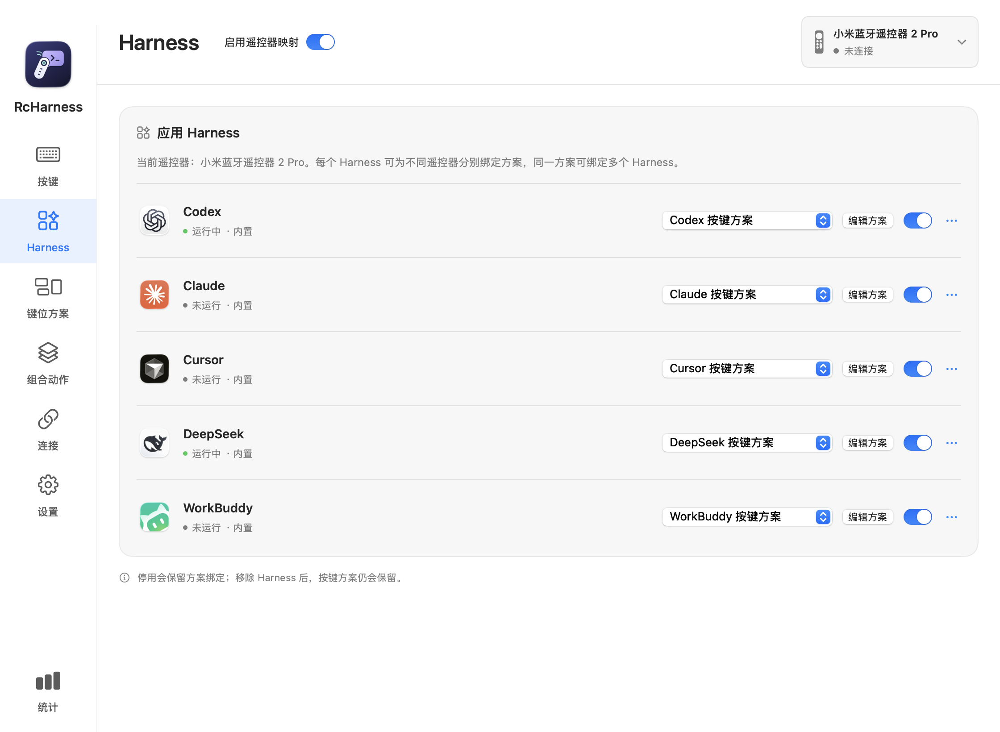
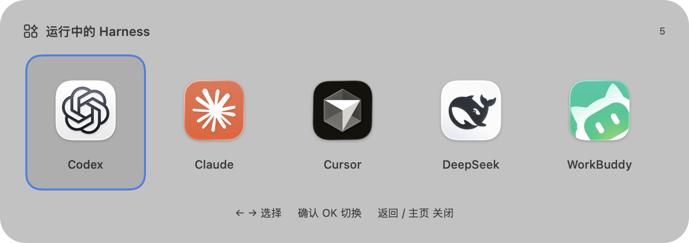
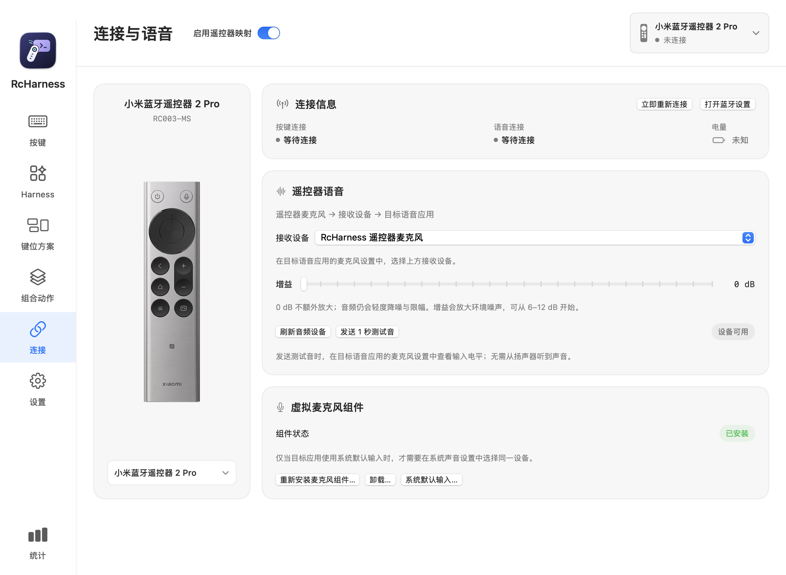
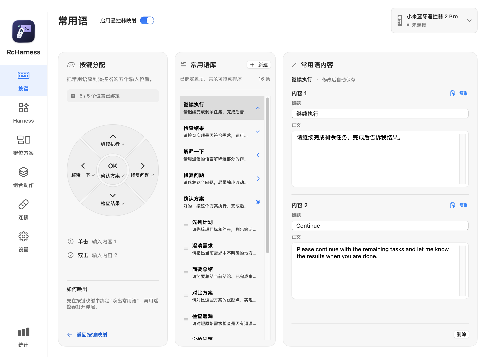
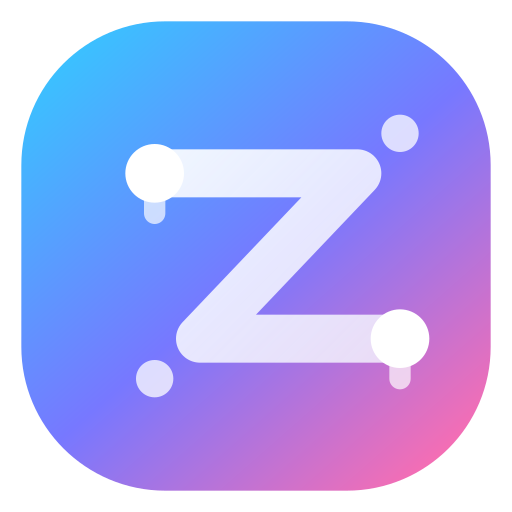

# RcHarness

RcHarness 是一款原生 macOS 菜单栏应用，通过蓝牙遥控器操作 Codex、Claude、Cursor 等 AI 对话与编程应用。支持自定义按键、应用切换、常用语输入和按住说话，无需额外转接硬件。

**按键方案随当前 Harness 应用自动切换**，同一实体按键可在不同软件中执行不同动作。

**运行环境：Apple Silicon Mac · macOS 14+ · 简体中文界面**

[下载应用](https://github.com/tokenzz-vip/RcHarness/releases) · [快速开始](#快速开始) · [反馈问题](https://github.com/tokenzz-vip/RcHarness/issues)



## 核心功能

- **自定义按键**：为单击、双击和长按设置快捷键、鼠标操作、系统动作或常用语。
- **应用与方案**：为不同 Harness 应用绑定各自的按键方案，切换应用时自动加载对应方案。
- **快速切换**：通过遥控器唤出运行中的 Harness 列表，选择并切换应用。
- **语音输入**：通过虚拟麦克风将遥控器音频传递给语音应用，支持按住说话。
- **常用语**：保存常用指令，分配至五向按键；单击、双击分别输入两组内容。
- **组合动作**：将多个操作与等待时间编排为可重复执行的动作。
- **配置与诊断**：支持配置导入导出、连接诊断和本机使用统计；统计不记录音频或听写内容。

## 界面预览

### 应用与方案

每个 Harness 应用可绑定独立的按键方案。切换到 Codex、Claude 或 Cursor 等时，RcHarness 自动加载该应用对应的方案，让按键操作适配当前软件的快捷键与工作流。

方案按遥控器型号分别保存，也可由多个应用共用；全局按键与语音触发设置在同一遥控器型号的方案间共享。



### 快速切换 Harness

默认**单击电源键**唤出运行中的 Harness 列表，使用**左右方向键**选择应用，按**确认 OK**切换。切换后自动应用目标软件绑定的按键方案；按返回或主页键可关闭列表。



### 连接与语音

集中查看按键与语音连接状态，选择音频接收设备、调整增益并发送测试音。虚拟麦克风组件可在此安装或更新。



### 常用语

内置继续执行、检查结果、解释一下等常用指令，支持编辑、排序和五向分配。每条常用语可保存两组内容，用于中英文指令或不同表达。



## 系统与设备

| 遥控器 | 型号 | 支持能力 |
|---|---|---|
| 小米蓝牙遥控器 2 | RC001-MS | 按键映射、按住说话 |
| 小米蓝牙遥控器 2 Pro | RC003-MS | 按键映射、按住说话 |
| Google Chromecast 遥控器 | G9N9N | 按键映射、按住说话、点按说话 |

> **兼容性提示**：Google 遥控器仅验证了拼多多店铺「金利达数码科技大全」销售的 G9N9N。其他店铺、批次或同型号产品尚未验证，兼容性不作保证。

Chromecast 遥控器另提供点按语音模式，固件兼容性需实机确认；小米遥控器仅支持按住说话。触发模式与快捷键选择见[行为说明](docs/behavior.md)。

## 快速开始

1. 从 [发布页面](https://github.com/tokenzz-vip/RcHarness/releases) 下载应用压缩包，解压后将 `RcHarness.app` 移入“应用程序”。
2. 在 macOS 蓝牙设置中配对遥控器，在 RcHarness 的“连接与语音”页选择对应型号。
3. 在“设置”页按提示授予蓝牙、输入监控和辅助功能权限。
4. 在“Harness”页添加或选择应用并绑定键位方案，在“按键”页点击卡片配置动作。
5. 需要语音输入时，在“连接与语音”页安装虚拟麦克风组件，在语音应用中选择相同的接收设备，并分别授予 RcHarness 和语音应用麦克风权限。

虚拟麦克风组件随应用提供，首次安装需要管理员授权。RcHarness 负责传递音频，语音识别由目标语音应用处理。

默认电源键操作：**单击**打开运行中的应用列表，**双击**区域截图，**长按**切换至原生模式。可从主面板或菜单栏恢复映射，也可自行调整全局按键。

## 常见问题

- **按键无反应或重复触发**：检查“输入监控”“辅助功能”权限和“启用遥控器映射”开关；退出其他遥控器映射软件，再关闭并重新开启映射。
- **语音没有声音**：检查“连接与语音”页的语音连接、接收设备和测试音，确认语音应用选择了同一输入设备，并已获得麦克风权限。
- **需要反馈问题**：附上应用版本、macOS 版本、遥控器型号和复现步骤；通过“设置 → 诊断与支持 → 复制诊断信息”获取状态。音频诊断日志位于 `~/Library/Logs/RcHarness/audio.log`，只记录计数和时延。
- **窗口和菜单无响应**：强制退出前，在源码仓库运行 `scripts/capture_hang.sh` 采集线程与日志，结果位于 `.build/diagnostics/`。

## 开发

项目使用 Swift、SwiftUI 和 Swift Package Manager，通过 Sparkle 2 提供应用内更新（SwiftPM 固定版本及校验和）。当前 CI 与发布使用 **Xcode 27.1 / Swift 6.4**，最低运行系统为 macOS 14。

本机构建前，将 `RC_HARNESS_LOCAL_SIGNING_IDENTITY` 设置为 `security find-identity -v -p codesigning` 列出的有效 Apple 签名身份，值不能是 `-`。若配置在 `~/.zshrc` 中，非交互构建时通过 `zsh -ic` 加载。

```bash
scripts/test_all.sh
scripts/build_app.sh .build/RcHarness.app
open .build/RcHarness.app
```

`test_all.sh` 包含单元测试、HAL 驱动 ASan/UBSan 测试和音频探针；缺少权限或回环设备时跳过音频探针。仅运行单元测试可用 `swift test`。构建后，应用及随包 HAL 驱动应使用同一签名身份，并通过 `codesign --verify --deep --strict` 校验。

音频主线程时延测量：`scripts/test_audio_output.sh --latency` 输出健康查询、调度、flush、停止及设备枚举的耗时分布；`scripts/capture_audio_latency.sh 30` 采集 Instruments 时间区间和等待线程。基线结果与尚待验证的异常场景见[专项测量记录](docs/audio-main-thread-latency.md)。

界面改动后导出截图检查布局；此模式使用临时配置，不连接遥控器：

```bash
.build/RcHarness.app/Contents/MacOS/RcHarness --render-settings /tmp/rcharness-pages
.build/RcHarness.app/Contents/MacOS/RcHarness --render-settings /tmp/rcharness-pages-dark --dark --narrow
```

详细说明：[界面与运行时行为](docs/behavior.md) · [小米 RC001-MS 适配](docs/xiaomi-rc001.md) · [Google G9N9N 适配](docs/google-g9n9n.md)

### 应用内更新与发布

在「设置」点击「检查更新…」，可在应用内查看新版本、下载、校验签名并重启安装。「自动检查更新」默认关闭，开启后由 Sparkle 定期检查，安装仍需用户确认。上次检查时间随设置保留。

应用升级重启后，若本机已安装的虚拟麦克风组件版本较旧，会自动发起同步更新并请求 macOS 管理员授权；更新会短暂重启系统音频服务。取消或失败时在「连接与语音」重试。未安装组件的用户不会被自动安装。

更新源为 GitHub Releases 最新正式版本的 `appcast.xml` 附件。首次接入前的旧版本仍需手动下载一次包含更新功能的新版。实现及发布维护步骤见 [更新发布说明](docs/app-updates.md)。

## 赞助商

| 赞助商 | 介绍 |
|---|---|
| <a href="https://tokenzz.vip/"></a> | 我们只是 token 的搬运工，官方纯净 token 转发。 |

## 致谢

感谢 [JoyHarness](https://github.com/nixihz/JoyHarness) 与 [无线麦 SayAll](https://github.com/HD838A/remote-mic-app) 提供的遥控器按键、蓝牙语音及虚拟麦克风实现参考。

## 许可证

Copyright (c) 2026 tokenzz-vip。以 [GNU 通用公共许可证 v3.0（GPL-3.0-only）](LICENSE) 发布。
