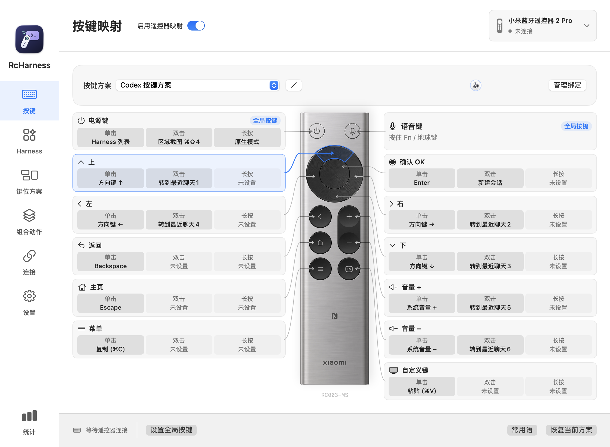
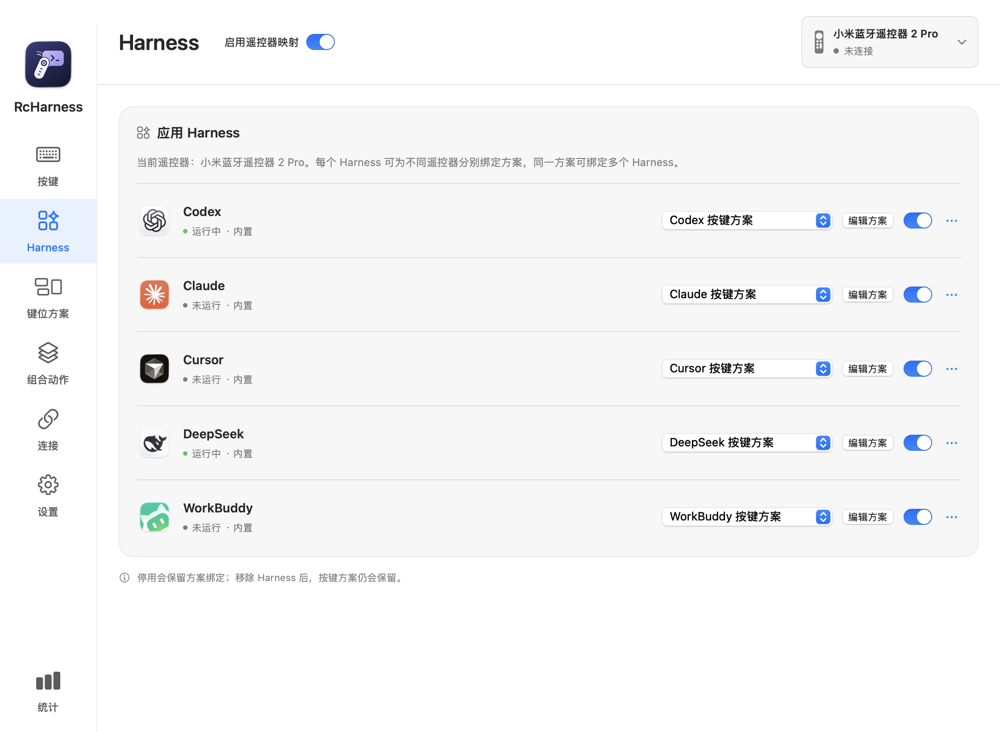
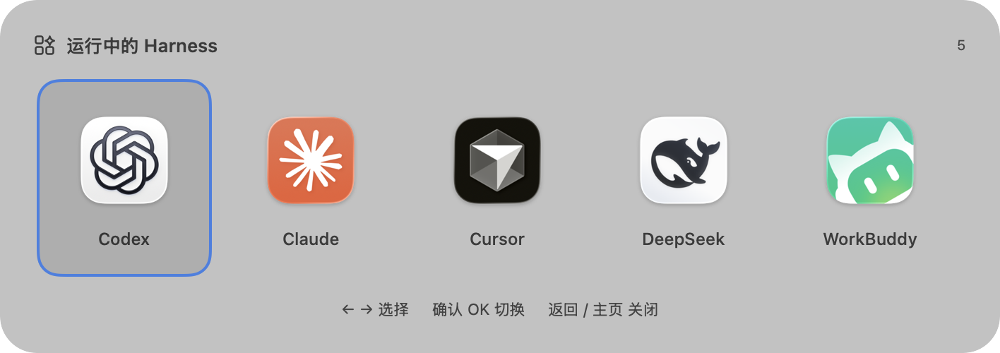
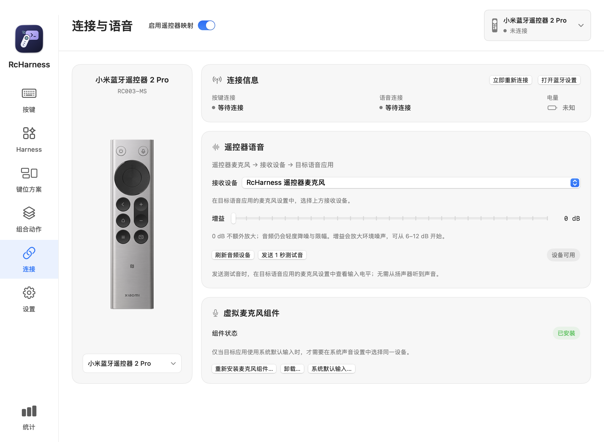
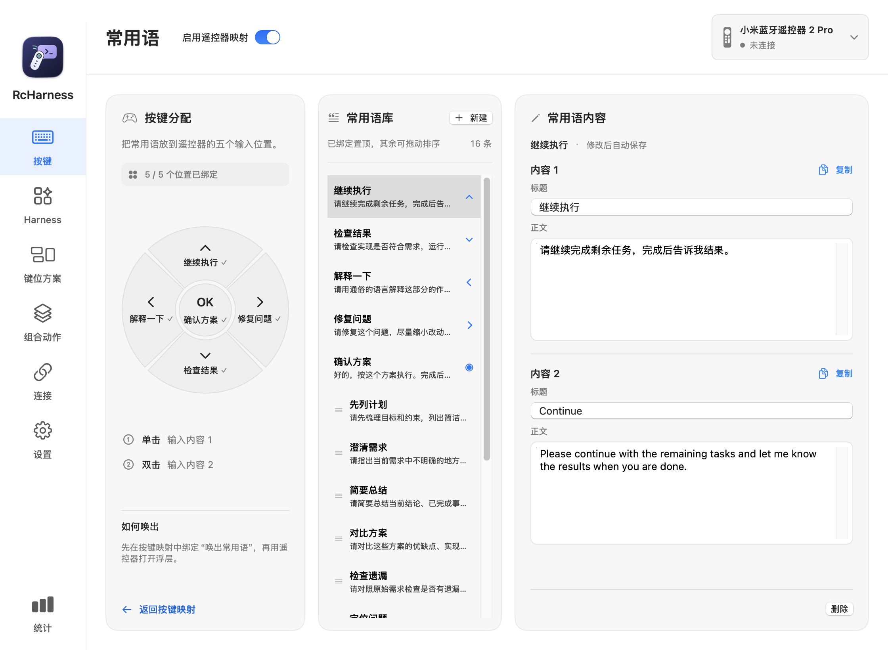
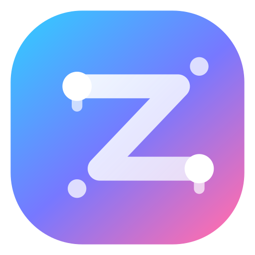

<p align="center">
  
</p>

# RcHarness

RcHarness 是一款原生 macOS 菜单栏应用，通过蓝牙遥控器操作 ChatGPT、Claude、Cursor、DeepSeek、WorkBuddy、OpenCode 等 AI 对话与编程应用。支持自定义按键、应用切换、常用语输入和语音输入，无需额外转接硬件。

**按键方案随当前 Harness 应用自动切换**，同一实体按键可在不同软件中执行不同动作。

**运行环境：Intel 或 Apple Silicon Mac · macOS 14+ · 简体中文界面**

[下载应用](https://github.com/tokenzz-vip/RcHarness/releases) · [快速开始](#快速开始) · [反馈问题](https://github.com/tokenzz-vip/RcHarness/issues)



## 核心功能

- **自定义按键**：为单击、双击和长按设置快捷键、鼠标操作、系统动作或常用语。
- **应用与方案**：管理 ChatGPT、Claude、Cursor、DeepSeek、WorkBuddy、OpenCode 及自定义应用，为不同 Harness 绑定各自的按键方案，切换应用时自动加载对应方案。
- **快速切换**：通过遥控器唤出运行中的 Harness 列表，选择并切换应用。
- **全局按键**：为当前遥控器配置跨 Harness、跨方案生效的电源键、主页键、TV／输入源键及其他全局按键；语音键独立配置。
- **语音输入**：通过虚拟麦克风将遥控器音频传递给语音应用；小米支持按住说话，Chromecast G9N9N 还支持点按模式。
- **常用语**：保存常用指令，分配至五向按键；单击、双击分别输入两组内容。
- **组合动作**：将多个操作与等待时间编排为可重复执行的动作。
- **系统操作**：可将按键绑定到显示桌面、查看所有窗口、切换应用、原生模式等 macOS 操作。
- **配置与诊断**：支持配置导入导出、替换前恢复、连接诊断、应用内更新和本机使用统计；统计不记录音频或听写内容。

## 界面预览

### 按键映射

“按键映射”页按当前遥控器展示实体按键和连接线，分别配置单击、双击、长按动作；普通动作、组合动作、常用语、系统操作和语音触发都从这里进入。映射开关位于页面标题旁，底部可恢复当前方案的默认映射。

### Harness 与键位方案

“Harness”页显示内置和手动添加的应用，可查看运行状态、启用或停用 Harness，并绑定当前遥控器的键位方案。当前内置 ChatGPT、Claude、Cursor、DeepSeek、WorkBuddy、OpenCode；自定义应用可继续添加。

“键位方案”页按遥控器型号列出方案。一个方案可以绑定多个 Harness，修改后同时对所有绑定应用生效；同一 Harness 在不同遥控器上可以使用不同方案。全局按键与语音触发设置独立于方案，在当前遥控器的所有方案和 Harness 间共享。



### 快速切换 Harness

默认**单击电源键**唤出运行中的 Harness 列表，使用**左右方向键**选择应用，按**确认 OK**切换。切换后自动应用目标软件绑定的按键方案；按返回或主页键可关闭列表。列表只显示已启用且正在运行的 Harness。



### 连接与语音

“连接与语音”页集中显示当前遥控器、按键连接、语音连接和电量，选择音频接收设备、调整增益并发送测试音。虚拟麦克风组件可在此安装、更新或卸载；组件升级需要管理员授权，并会短暂重启系统音频服务。



### 常用语

“常用语”从按键映射页进入。内置继续执行、检查结果、解释一下等常用指令，支持编辑、排序和五向分配；每条常用语可保存两组内容，用于中英文指令或不同表达。遥控器浮层中，上下左右和 OK 分别对应五个位置，单击输入内容 1，双击输入内容 2。



### 组合动作、设置与统计

“组合动作”页把多个按键、鼠标、系统操作、常用语或其他组合动作串成一个动作，并可设置步骤间等待时间和标签筛选。“设置”页包含当前遥控器的全局按键、蓝牙／输入监控／辅助功能／麦克风权限、配置导入导出与替换前恢复、启动行为、主题模式、应用内更新和诊断信息。“使用统计”页按时间范围显示按键次数、语音时长、使用天数、图表和排行，数据只保存在本机。

## 系统与设备

| 遥控器 | 型号 | 支持能力 |
|---|---|---|
| 小米蓝牙遥控器 2 | RC001-MS | 按键映射、按住说话 |
| 小米蓝牙遥控器 2 Pro | RC003-MS | 按键映射、按住说话 |
| Google Chromecast 遥控器 | G9N9N | 按键映射、按住说话、点按说话 |

> [!CAUTION]
> **兼容性提示**
>
> Google 遥控器仅验证了拼多多店铺「金利达数码科技大全」销售的 G9N9N。**其他店铺、批次或同型号产品尚未验证，兼容性不作保证。**

Chromecast 遥控器首次建立配置时默认使用点按语音模式，也可在“按键 → 语音键”切换为按住模式；固件兼容性需实机确认。小米遥控器仅支持按住说话，点按卡片会保持不可用。两种模式的快捷键和生命周期见[行为说明](docs/behavior.md)。

## 快速开始

1. 下载对应架构的 DMG：Apple Silicon 选 [RcHarness-macos-arm64.dmg](https://github.com/tokenzz-vip/RcHarness/releases/latest/download/RcHarness-macos-arm64.dmg)，Intel 选 [RcHarness-macos-x86_64.dmg](https://github.com/tokenzz-vip/RcHarness/releases/latest/download/RcHarness-macos-x86_64.dmg)（固定链接始终指向最新正式版），打开后将 `RcHarness.app` 拖入“应用程序”。
2. 在 macOS 蓝牙设置中配对遥控器，在 RcHarness 的“连接与语音”页选择对应型号。
3. 在“设置”页按提示授予蓝牙、输入监控和辅助功能权限。
4. 在“Harness”页启用或添加应用，在“键位方案”页创建或选择方案并绑定应用，再到“按键映射”页点击卡片配置动作。
5. 需要语音输入时，在“连接与语音”页安装虚拟麦克风组件，在语音应用中选择相同的接收设备，并分别授予 RcHarness 和语音应用麦克风权限。

虚拟麦克风组件随应用提供，首次安装需要管理员授权。RcHarness 负责传递音频，语音识别由目标语音应用处理。

默认全局按键如下，对当前遥控器的所有方案和 Harness 生效：

| 按键 | 单击 | 双击 | 长按 |
|---|---|---|---|
| 电源键 | 打开运行中的 Harness 列表 | 未设置 | 停止遥控器映射 |
| 主页键 | 显示桌面 | Escape | 未设置 |
| 小米 TV 键／Chromecast 输入源键 | 切换应用 | 查看所有窗口 | 显示桌面 |

这三项固定保留，第一项必选，后两项可留空。可在“设置 → 全局按键”增加其他全局按键，也可从主面板或菜单栏恢复当前方案映射。

## 常见问题

- **按键无反应或重复触发**：检查“输入监控”“辅助功能”权限和“启用遥控器映射”开关；退出其他遥控器映射软件，再关闭并重新开启映射。
- **语音没有声音**：检查“连接与语音”页的语音连接、接收设备和测试音，确认语音应用选择了同一输入设备，并已获得麦克风权限。
- **想切换语音触发方式**：在“按键映射”页打开语音键，Chromecast 可选择长按或点按及对应快捷键；小米遥控器只支持长按。
- **配置需要迁移到另一台 Mac**：在“设置 → 配置导入与导出”导出配置文件；导入时先查看预览，确认后才替换当前配置。每次替换会保留一份可恢复的替换前配置。
- **需要反馈问题**：打开「设置 → 诊断与支持 → 提交反馈」，描述问题并附上复现步骤。表单会填写版本和遥控器型号，可以预览并勾选诊断信息。也可以通过「复制诊断信息」获取完整状态。音频诊断日志位于 `~/Library/Logs/RcHarness/audio.log`，只记录计数和时延。应用内直提接口见[反馈服务部署](services/feedback/README.md)。
- **窗口和菜单无响应**：强制退出前，在源码仓库运行 `scripts/capture_hang.sh` 采集线程与日志，结果位于 `.build/diagnostics/`。

## 开发

项目使用 Swift、SwiftUI 和 Swift Package Manager，通过 Sparkle 2 提供应用内更新（SwiftPM 固定版本及校验和）。ARM CI 与发布使用 **Xcode 27.1 / Swift 6.4**，Intel 使用 `macos-15-intel` runner 自带的 Xcode / Swift 工具链，最低运行系统为 macOS 14。

`scripts/build_app.sh` 默认只构建当前进程架构，可通过 `RC_HARNESS_ARCH=arm64` 或 `RC_HARNESS_ARCH=x86_64` 明确指定。主程序、HAL 驱动及 Sparkle 框架和辅助进程均只保留目标架构，打包时逐一检查架构和最低系统版本。CI 分别在 ARM 与 Intel runner 上执行原生测试和构建；发布流程分别签名、公证，待两种架构都成功后统一发布 DMG 及各自的更新源，安装包仅提供 DMG 格式。Sparkle 更新源使用 DMG。Intel 真机上的蓝牙、HID 和 HAL 加载仍需端到端验收；Rosetta 测试不能替代硬件验收。

本机构建前，将 `RC_HARNESS_LOCAL_SIGNING_IDENTITY` 设置为 `security find-identity -v -p codesigning` 列出的有效 Apple 签名身份，值不能是 `-`。若配置在 `~/.zshrc` 中，非交互构建时通过 `zsh -ic` 加载。

```bash
scripts/test_all.sh
scripts/build_app.sh .build/RcHarness.app
open .build/RcHarness.app

# 分别构建（也支持交叉编译）；使用独立输出目录保留两个版本。
RC_HARNESS_ARCH=arm64 scripts/build_app.sh .build/apps/arm64/RcHarness.app
RC_HARNESS_ARCH=x86_64 scripts/build_app.sh .build/apps/x86_64/RcHarness.app
```

`test_all.sh` 包含构建/更新源脚本测试、Swift 单元测试、HAL 驱动 ASan/UBSan 测试和音频探针；缺少权限或回环设备时跳过音频探针。仅运行单元测试可用 `swift test`。构建后，应用及随包 HAL 驱动应使用同一签名身份，并通过 `codesign --verify --deep --strict` 校验。

音频主线程时延测量：`scripts/test_audio_output.sh --latency` 输出健康查询、调度、flush、停止及设备枚举的耗时分布；`scripts/capture_audio_latency.sh 30` 采集 Instruments 时间区间和等待线程。基线结果与尚待验证的异常场景见[专项测量记录](docs/audio-main-thread-latency.md)。

界面改动后导出截图检查布局；此模式使用临时配置，不连接遥控器：

```bash
.build/RcHarness.app/Contents/MacOS/RcHarness --render-settings /tmp/rcharness-pages
.build/RcHarness.app/Contents/MacOS/RcHarness --render-settings /tmp/rcharness-pages-dark --dark --narrow
# 按当前型号导出指定 Harness 的映射（默认 chatgpt）
.build/RcHarness.app/Contents/MacOS/RcHarness --render-settings /tmp/rcharness-claude --remote-profile xiaomi-rc001 --harness claude
```

详细说明：[界面与运行时行为](docs/behavior.md) · [小米 RC001-MS 适配](docs/xiaomi-rc001.md) · [Google G9N9N 适配](docs/google-g9n9n.md)

### 应用内更新与发布

在「设置」点击「检查更新…」，可在应用内查看新版本、下载、校验签名并重启安装。「自动检查更新」默认关闭，开启后由 Sparkle 定期检查，安装仍需用户确认。上次检查时间随设置保留。

应用升级重启后，若本机已安装的虚拟麦克风组件版本较旧，会自动发起同步更新并请求 macOS 管理员授权；更新会短暂重启系统音频服务。取消或失败时在「连接与语音」重试。未安装组件的用户不会被自动安装。

更新源为 GitHub Releases 最新正式版本的 `appcast-arm64.xml` 或 `appcast-x86_64.xml` 附件，分别对应 Apple Silicon 和 Intel 的 DMG 安装包。旧版 Universal 应用仍使用 `appcast.xml`，切换时需从版本历史手动下载一次对应架构的新版，之后自动沿用该架构更新源。实现及发布维护步骤见 [更新发布说明](docs/app-updates.md)。

## 赞助商

| 赞助商 | 介绍 |
|---|---|
| <a href="https://tokenzz.vip/"></a> | 我们只是 token 的搬运工，官方纯净 token 转发。 |

## 致谢

感谢 [JoyHarness](https://github.com/nixihz/JoyHarness) 与 [无线麦 SayAll](https://github.com/HD838A/remote-mic-app) 提供的遥控器按键、蓝牙语音及虚拟麦克风实现参考。

## 许可证

Copyright (c) 2026 tokenzz-vip。以 [GNU 通用公共许可证 v3.0（GPL-3.0-only）](LICENSE) 发布。

## Star History

<a href="https://www.star-history.com/#tokenzz-vip/RcHarness&Date">
  <picture>
    <source media="(prefers-color-scheme: dark)" srcset="https://api.star-history.com/svg?repos=tokenzz-vip/RcHarness&amp;type=Date&amp;theme=dark">
    <source media="(prefers-color-scheme: light)" srcset="https://api.star-history.com/svg?repos=tokenzz-vip/RcHarness&amp;type=Date">
    
  </picture>
</a>
